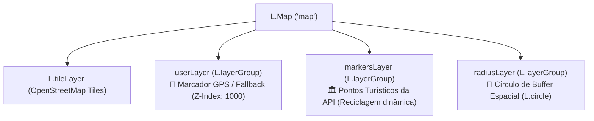
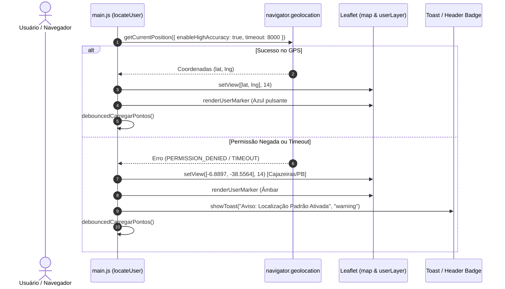

# GeoTurismo — Frontend Core & WebGIS (Dev 2)

Interface cartográfica interativa para visualização e consulta espacial de pontos turísticos, desenvolvida com **Leaflet.js** e integrada diretamente aos recursos geoespaciais da API REST respaldada pelo **PostgreSQL + PostGIS**.

Este módulo foi construído sob responsabilidade do **Dev 2 (Frontend Core & Leaflet)**, implementando a fundação cartográfica da aplicação, a geolocalização do usuário, as consultas dinâmicas por área visível (Bounding Box) e a delimitação espacial por raio de proximidade (Buffer).

---

## 1. Visão Geral & Stack Tecnológica

O frontend do **GeoTurismo** foi projetado para atuar como um **WebGIS** leve, reativo e acessível. A interface opera em modo tela cheia (*full-viewport*), priorizando a interação com o mapa e disponibilizando controles flutuantes com visual moderno baseado em *Glassmorphism*.

### Tecnologias Utilizadas

| Tecnologia | Finalidade no Projeto |
| :--- | :--- |
| **Leaflet.js 1.9.4** | Biblioteca cartográfica de referência para renderização de camadas vetoriais (`L.Marker`, `L.Circle`), grupos de camadas (`L.LayerGroup`) e ladrilhos raster baseados no OpenStreetMap. |
| **Vite 6.1.1** | Ferramenta de build e servidor de desenvolvimento com suporte nativo a ES Modules (ESM) e Hot Module Replacement (HMR). |
| **JavaScript Vanilla (ES6+)** | Lógica da aplicação modularizada, sem sobrecarga de frameworks externos pesados, garantindo performance de renderização máxima em dispositivos móveis e desktop. |
| **HTML5 Semântico & Acessibilidade** | Estruturação com cabeçalho de controle (`#app-header`), viewport cartográfico (`#map`), painel flutuante de notificações com `aria-live="polite"` e atributos ARIA para leitores de tela. |
| **CSS3 & Design System WebGIS** | Paleta semântica com CSS Variables (`--primary-color`, `--secondary-color`, `--accent-color`), efeitos de Glassmorphism com `backdrop-filter: blur()`, design responsivo e animações `@keyframes` (`gpsPulse` e `badgePulse`). |

---

## 2. Arquitetura de Arquivos e Estado Global (`window.geoTurismo`)

### Estrutura de Diretórios

```text
frontend/
├── index.html              # Shell HTML semântico com viewport e slots de controle
├── package.json            # Manifesto de dependências (Leaflet, Vite) e scripts
├── README.md               # Documentação técnica do módulo Frontend (Dev 2)
└── src/
    ├── main.js             # Lógica central WebGIS, camadas Leaflet, US01, US02 e US03
    └── style.css           # Design System WebGIS, glassmorphism e animações CSS
```

---

### Arquitetura de Camadas do Leaflet (`L.layerGroup`)

Para evitar renderizações desnecessárias e viabilizar a reciclagem atômica de elementos gráficos sem interferência mútua, a cartografia foi estruturada em três camadas independentes:



1. **`userLayer` (Camada do Usuário):**
   - Grupo isolado para o marcador de geolocalização do usuário.
   - Possui prioridade visual permanente (`zIndexOffset: 1000`) para não ser encoberto pelos pontos turísticos.
   - **Não é limpa** quando o mapa é arrastado ou quando filtros de busca são aplicados.

2. **`markersLayer` (Camada de Pontos Turísticos):**
   - Grupo dinâmico reservado exclusivamente para renderizar os marcadores provenientes da API (`GET /api/pontos` ou `GET /api/pontos/proximidade`).
   - Gerenciada pelo método `renderizarPontos(pontos)`. A cada nova requisição espacial, executa `markersLayer.clearLayers()`, reciclhando a memória e evitando duplicação de dados na tela.

3. **`radiusLayer` (Camada do Buffer de Proximidade):**
   - Grupo dedicado para desenhar o anel geométrico (`L.circle`) que representa o raio de busca em metros.
   - Limpa via `radiusLayer.clearLayers()` sempre que o raio é alterado ou quando a busca por raio é desativada.

---

### API Pública de Integração (`window.geoTurismo`) — Guia para o Dev 3

Para garantir o perfeito desacoplamento entre o **Core/WebGIS (Dev 2)** e o **CRUD de Pontos Turísticos (Dev 3 - US04, US05, US06)**, o módulo expõe uma API global estruturada em `window.geoTurismo`:

```javascript
// Exposição disponível no console ou para scripts externos
window.geoTurismo = {
  map,                    // Instância principal do L.Map
  userLocation,           // { lat, lng } atual (GPS ou Fallback de Cajazeiras)
  userLayer,              // L.layerGroup do usuário
  markersLayer,           // L.layerGroup dos pontos turísticos
  radiusLayer,            // L.layerGroup do círculo de proximidade
  API_BASE_URL,           // URL base da API (ex: http://localhost:3000/api)
  isRadiusSearchActive,   // Flag de controle booleana
  setRadiusSearchActive,  // (active: boolean) => void
  carregarPontosPorBBox,  // () => Promise<Array|null> (Recarrega área visível)
  buscarPontosPorRaio,    // (raioKm: number|string) => Promise<Array|null>
  desativarBuscaPorRaio,  // (resetSelect?: boolean) => void
  formatarDistancia,      // (metros: number) => string (ex: "450 m" ou "2.5 km")
  locateUser,             // (options?: { notifySuccess: boolean }) => void
  renderizarPontos,       // (pontos: Array) => void
  atualizarStatusPontos,  // (count, isLoading, isError, customText) => void
  showToast               // (message, type, title, duration) => void
};
```

#### 📌 Recomendações de Integração para o Dev 3:
1. **Slot do Header (`#crud-control-placeholder`):**
   - No `index.html`, o elemento `<div id="crud-control-placeholder" class="header-slot"></div>` está reservado para receber o botão **"+ Novo Ponto"** da **US04**.
2. **Atualização do Mapa após Operações de CRUD:**
   - Após cadastrar um novo ponto (**US04**), editar dados (**US05**) ou excluir um ponto (**US06**), basta invocar:
     ```javascript
     window.geoTurismo.carregarPontosPorBBox();
     // ou utilizar o atalho direto:
     window.carregarPontosPorBBox();
     ```
   - O método recarregará a área visível imediatamente, refletindo as alterações no banco de dados sem recarregar a página (*SPA experience*).
3. **Ações no Popup do Ponto Turístico:**
   - Cada popup gerado por `renderizarPontos()` inclui uma `div` identificada para inserção dinâmica de botões de Ação:
     ```html
     <div class="ponto-popup-actions" id="ponto-actions-${ponto.id}">
       <!-- Injetar botões de Editar (US05) e Excluir (US06) aqui -->
     </div>
     ```

---

## 3. Funcionalidades Implementadas (User Stories — Dev 2)

### US01 — Centralização Automática por Geolocalização (Issue #1)

Permite ao usuário visualizar sua posição atual em relação aos pontos turísticos da região, com tratamento robusto para recusas de permissão ou limitações de hardware.



- **Configuração de Alta Precisão:**
  ```javascript
  const geoOptions = {
    enableHighAccuracy: true,
    timeout: 8000,
    maximumAge: 0
  };
  ```
- **Marcador Customizado em Caso de Sucesso:**
  - Ícone via `L.divIcon` com elemento central `.gps-core` e anel de propagação animado `.gps-pulse` na cor azul ciano (`#0284c7`).
  - Centralização no mapa com nível de aproximação **Zoom 14**.
  - Popup e Tooltip automáticos: `"📍 Você está aqui"`.
- **Fallback Gracioso (Sem Travamentos):**
  - Caso o usuário negue o acesso, o GPS esteja desligado ou o tempo limite (8s) se esgote, a função `handleLocationFallback` é acionada.
  - Coordenadas de contingência: **Cajazeiras/PB** (`lat: -6.8897`, `lng: -38.5564`).
  - O marcador é renderizado em tom âmbar (`#f59e0b`, classes `.fallback-gps-core` e `.fallback-gps-pulse`).
  - Uma notificação não bloqueante via Toast é emitida, informando o motivo de forma amigável e acessível (`aria-live="polite"`).
- **Recentralização Manual:**
  - Botão interativo no header (`#btn-my-location`) permite reobter as coordenadas e recentralizar o mapa a qualquer momento.

---

### US02 — Carregamento Otimizado por Bounding Box (Issue #2)

Garante escalabilidade e eficiência de tráfego de rede ao buscar no PostGIS apenas os pontos que estão dentro do retângulo visível da tela do usuário.

```
       maxLat (Norte)
  +-----------------------+ (maxLng, maxLat)
  |                       |
  |    Área Visível       |
  |     do Leaflet        |
  |                       |
  +-----------------------+
(minLng, minLat)
       minLat (Sul)
```

- **Captura da Viewport Espacial:**
  - Obtida via `map.getBounds()`:
    ```javascript
    const bounds = map.getBounds();
    const minLng = bounds.getWest();
    const minLat = bounds.getSouth();
    const maxLng = bounds.getEast();
    const maxLat = bounds.getNorth();
    ```
- **Prevenção de Requisições Excessivas (Debounce de 400ms):**
  - O evento `moveend` do Leaflet dispara sempre que o mapa é arrastado ou o nível de zoom é alterado.
  - O utilitário `debounce(func, 400)` suspende o envio da requisição até que o usuário pare a navegação por no mínimo 400 milissegundos, evitando sobrecarga desnecessária na API e no banco.
- **Integração com Endpoint PostGIS:**
  - Requisição: `GET /api/pontos?bbox=minLng,minLat,maxLng,maxLat`
  - No Backend, a consulta é resolvida utilizando `ST_MakeEnvelope` e `ST_Intersects` sobre o índice GiST.
- **Reciclagem de Camada Gráfica:**
  - Execução de `markersLayer.clearLayers()` antes de plotar os pontos recebidos, garantindo que marcadores fora da tela sejam descartados da memória do DOM.
  - Preserva intacto o marcador de posição do usuário na `userLayer`.
- **Feedback Visual de Status (`#points-status-badge`):**
  - Ponto pulsante verde (*Sincronizado*), azul pulsante (*Carregando área...*) ou vermelho (*Erro de Conexão*), acompanhado do contador de pontos visíveis.

---

### US03 — Busca Espacial por Raio de Proximidade (Issue #3)

Permite ao turista pesquisar atrativos em um raio de alcance a partir de sua localização de referência (obtida via GPS ou Fallback).

- **Seletor Interativo e Conversão:**
  - Dropdown `#select-radius` integrado ao cabeçalho com opções de **1 km, 2 km, 5 km, 10 km, 20 km e 50 km**.
  - Conversão instantânea de quilômetros para metros:
    ```javascript
    const raioMetros = parseFloat(raioKm) * 1000;
    ```
- **Desenho do Buffer Espacial (`L.circle`):**
  - O círculo translúcido é renderizado na `radiusLayer` centrado em `userLocation`:
    ```javascript
    const circle = Leaflet.circle([userLocation.lat, userLocation.lng], {
      radius: raioMetros,
      color: '#0284c7',
      fillColor: '#38bdf8',
      fillOpacity: 0.15,
      dashArray: '6, 6'
    });
    ```
- **Ajuste Automático de Viewport:**
  - O mapa se enquadra suavemente para exibir exatamente a extensão do círculo:
    ```javascript
    map.fitBounds(circle.getBounds(), { padding: [30, 30], maxZoom: 16 });
    ```
- **🛡️ Prevenção de Conflito de Corrida (Race Condition BBox vs. Raio):**
  - *Problema:* O comando `map.fitBounds()` provoca a movimentação do mapa, o que normalmente dispararia o evento `moveend`, disparando uma consulta por Bounding Box que sobrescreveria os pontos filtrados pelo raio.
  - *Solução Arquitetural:* A flag booleana `setRadiusSearchActive(true)` é ativada **antes** de chamar `map.fitBounds()`. Quando o evento `moveend` é acionado, a rotina de BBox verifica a flag e encerra a execução sem emitir requisições.
- **Consumo do Endpoint de Proximidade PostGIS:**
  - Requisição: `GET /api/pontos/proximidade?lng={userLocation.lng}&lat={userLocation.lat}&raio={raioMetros}`
  - No Backend, a busca é processada via `ST_DWithin(geom::geography, ...)` e ordenada por `ST_Distance`.
- **Exibição Formatada da Distância:**
  - O utilitário `formatarDistancia(metros)` converte a distância retornada pelo PostGIS para leitura amigável nos popups:
    - Menor que 1000 metros: ex: `"450 m"`
    - A partir de 1000 metros: ex: `"2.5 km"`
- **Restauração da Navegação:**
  - Botão `#btn-clear-radius` (✕) restaura o estado padrão (`setRadiusSearchActive(false)`), limpa o buffer geométrico e reativa o carregamento livre por Bounding Box.

---

## 4. Configuração, Variáveis de Ambiente e Execução Local

### Pré-requisitos
- **Node.js** (versão 18.x ou superior).
- **Backend do GeoTurismo** configurado e ativo na porta `3000` (conforme documentação em `backend/README.md`).

---

### Configuração de Ambiente (`.env`)

Na raiz do diretório `frontend/`, crie um arquivo `.env` baseado no exemplo abaixo:

```env
# URL base da API Backend do GeoTurismo
VITE_API_URL=http://localhost:3000/api
```

> **Nota:** Caso o arquivo `.env` não seja criado, o código possui fallback automático implementado em `main.js`:
> ```javascript
> export const API_BASE_URL = import.meta.env?.VITE_API_URL || 'http://localhost:3000/api';
> ```

---

### Passo a Passo para Execução

#### Opção A: Executar a partir da pasta `frontend/`
```bash
# 1. Navegue até o diretório do frontend
cd frontend

# 2. Instale as dependências
npm install

# 3. Inicie o servidor Vite em modo desenvolvimento
npm run dev
```

#### Opção B: Executar a partir da raiz do repositório
O projeto conta com scripts integrados no `package.json` raiz:
```bash
# Instala as dependências de backend e frontend de uma só vez
npm run install:all

# Inicia o servidor Vite do frontend
npm run dev:frontend
```

Após iniciar, o terminal indicará a URL local (normalmente `http://localhost:5173`). Abra o link no navegador.

---

### Scripts Disponíveis no `frontend/package.json`

| Comando | Descrição |
| :--- | :--- |
| `npm run dev` | Inicia o servidor de desenvolvimento do Vite com HMR ativo. |
| `npm run build` | Compila e minifica a aplicação para distribuição em produção na pasta `dist/`. |
| `npm run preview` | Inicia um servidor web estático local para inspecionar o pacote compilado em `dist/`. |

---

## 5. Guia de Testes e Validação (Cenários de Aceite & DevTools)

### Roteiro de Testes dos Critérios de Aceite

#### Teste 1: Centralização Automática e GPS (US01)
1. Abra a aplicação no navegador em `http://localhost:5173`.
2. Quando solicitado, clique em **Permitir** o acesso à localização.
3. **Validação:** O mapa centralizará em sua posição real com **Zoom 14**. Um marcador com anel pulsante azul (`#0284c7`) será exibido com popup `"📍 Você está aqui"`.

#### Teste 2: Fallback Gracioso de Localização (US01)
1. Abra a aplicação em uma aba anônima ou limpe as permissões do site clicando no cadeado ao lado da barra de endereço e altere "Localização" para **Bloquear**.
2. Recarregue a página (`F5`).
3. **Validação:** A aplicação não trava nem quebra. Um Toast de aviso (*Localização Padrão Ativada*) surge no canto superior direito. O mapa centraliza automaticamente em **Cajazeiras/PB** (`-6.8897, -38.5564`) exibindo um marcador em tom âmbar (`#f59e0b`).

#### Teste 3: Carregamento Otimizado por Bounding Box & Debounce (US02)
1. Pressione `F12` para abrir o DevTools e selecione a aba **Network (Rede)**.
2. Filtre as requisições por `pontos?bbox=`.
3. Clique e arraste o mapa repetidamente de forma rápida.
4. **Validação:** Observe que nenhuma requisição é disparada enquanto o mapa está em movimento contínuo. Exatamente **400ms após soltar o mouse**, apenas **uma única requisição HTTP** é enviada contendo os limites exatos da tela (`minLng, minLat, maxLng, maxLat`).
5. Observe o badge `#points-status-badge` no header alternar para "Carregando área..." e, em seguida, exibir a contagem atualizada de pontos visíveis.

#### Teste 4: Busca Espacial por Raio de Proximidade (US03)
1. Com a aba **Network** aberta, clique no dropdown de raio no header e selecione **"Raio de 5 km"**.
2. **Validação:**
   - Um círculo azul pontilhado com preenchimento translúcido é desenhado ao redor da sua posição.
   - O mapa reajusta o enquadramento automaticamente via `fitBounds()`.
   - Na aba Network, confirme o disparo de: `GET /api/pontos/proximidade?lng=...&lat=...&raio=5000`.
   - **Prevenção de Race Condition comprovada:** Nenhuma requisição concorrente de BBox (`pontos?bbox=`) é enviada após o `fitBounds()`.
   - O botão circular vermelho **`✕`** surge no header ao lado do seletor.
3. Clique em um marcador retornado: o popup exibirá a distância geodésica calculada (ex: `📍 A 1.2 km de você`).

#### Teste 5: Limpeza de Filtro de Raio
1. Clique no botão **`✕`** no header ou selecione `"Área Visível (Padrão)"` no dropdown.
2. **Validação:** O círculo geométrico é removido, o botão `✕` desaparece, um toast informa o retorno à visualização livre e a busca volta a operar no modo dinâmico por Bounding Box (`US02`).

---

### 🎓 Cola para a Apresentação / Arguição Acadêmica

Caso precise explicar para os avaliadores ou professores a integração entre o Frontend WebGIS e o PostGIS, utilize as associações diretas da tabela abaixo:

| Ação no Frontend (Leaflet) | Evento / Gatilho | Chamada na API REST | Função Espacial Executada no PostGIS |
| :--- | :--- | :--- | :--- |
| **Arraste de tela ou alteração de Zoom** | Evento `moveend` com Debounce (400ms) | `GET /api/pontos?bbox=minLng,minLat,maxLng,maxLat` | `ST_Intersects(geom, ST_MakeEnvelope(minLng, minLat, maxLng, maxLat, 4326))` acelerada pelo índice GiST na coluna `geom`. |
| **Seleção de Raio no Header (ex: 5 km)** | Evento `change` do `#select-radius` | `GET /api/pontos/proximidade?lng=...&lat=...&raio=5000` | `ST_DWithin(geom::geography, ST_SetSRID(ST_MakePoint(lng, lat), 4326)::geography, raio)` e distância calculada via `ST_Distance(geom::geography, ...)`. |
| **Reciclagem de Marcadores na Tela** | `markersLayer.clearLayers()` | Evita vazamento de memória e sobreposição de marcadores antigos ao navegar pelo mapa. | Não onera o banco de dados; resolve a limpeza atômica no cliente mantendo a `userLayer` intacta. |
| **Tratamento de Race Condition** | `setRadiusSearchActive(true)` antes de `map.fitBounds()` | Impede que a animação de enquadramento da câmera do Leaflet dispare inadvertidamente uma busca por Bounding Box concorrente. | Garante integridade transacional do estado da UI. |
